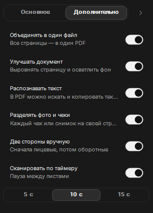

# Blick

Сканирование в Windows через WIA. Сохраняет документы и фотографии в PDF, JPG или PNG. Если подключено несколько сканеров, Blick сначала ищет Pantum. Если его нет, берёт первый сканер в списке.

Для сборки запустить `собрать.bat` из корня проекта. Скрипт найдёт компилятор .NET Framework 4.x и соберёт `Blick.exe` в той же папке.

## Один лист

Выбрать источник, формат файла и папку справа, затем нажать «Сканировать». Просмотр нужен, если хочется проверить, ровно ли лежит лист, или снять только его часть. Область сканирования можно выделить мышью прямо на изображении.

Уже готовый скан тоже можно обрезать. Для этого выбрать его миниатюру внизу, выделить то, что должно остаться, и нажать Enter.

## Несколько страниц

Для одного PDF выбрать формат PDF и включить «Объединять в один файл» на вкладке «Дополнительно». Там же включается распознавание, если потом понадобится искать или копировать текст.

Для двустороннего документа включить «Две стороны вручную». Сначала пропустить лицевые стороны, нажать «К оборотным», перевернуть стопку и пропустить её ещё раз. Blick сам расставит страницы по порядку.

Если на стекле лежат несколько чеков или фотографий, включить «Разделять фото и чеки». Тогда у каждого будет своя страница.

## На память

- `Ctrl+R` или `F5` заменяет результат последнего сканирования. Если через податчик прошла пачка, команда заменит всю пачку.
- Часы слева открывают историю сканов. Язык и масштаб меняются через шестерёнку вверху.
- Настройки хранятся в `%APPDATA%\Blick\settings.ini`, история сканов лежит рядом в `history.txt`.
