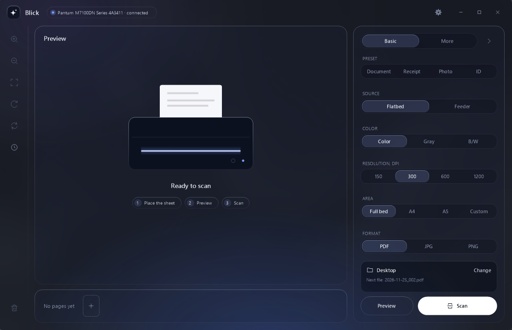

# ENG

## Blick - Universal Printer Software

[Download for Windows](https://github.com/nowheremarius/Blick-Universal-Printer-Software/releases/latest/download/Blick.exe)

Blick is a Windows desktop app for scanning documents, receipts and photos. It can save one file per page or collect a stack into a searchable PDF. It talks to scanners through Windows Image Acquisition (WIA), including the scanner in a multifunction printer.

### Build and run

Download or clone the repository. On Windows, open the project folder and run `build.bat`. The script looks for the .NET Framework 4.x C# compiler in the 64-bit and 32-bit Framework folders and builds `Blick.exe` alongside the source files. Run that executable to use the version you just built.

Turn on the scanner and make sure its WIA driver is installed. Blick looks for a device when it starts. If several scanners are available, it prefers one uses the first scanner it finds. Click the device name at the top to search again after connecting a scanner. The gear opens the language and interface scale settings.

### Make a scan

1. Put a sheet on the glass or load the feeder. Under **Basic**, set **Source** to **Flatbed** or **Feeder**. Choose a preset or set the color mode, resolution, area and output format yourself.
2. Check the destination at the bottom right. Click **Change** to pick a folder. Blick falls back to the Desktop if the selected folder no longer exists.
3. To check placement on the glass, click **Preview**. This takes a separate 150 dpi flatbed scan. Drag a rectangle on the preview to scan just that part. For a full sheet or a feeder batch, you can go straight to **Scan**.
4. Click **Scan**. Pages appear as thumbnails along the bottom. Blick saves the files to the destination folder. It uses names like `2026-11-25_001.pdf` and picks the next free number across PDF, JPG and PNG files for that date.

| Preset | Color and resolution | Area and format | Processing |
| --- | --- | --- | --- |
| Document | Gray, 300 dpi | A4, PDF | Straighten and lighten the page, recognize text |
| Receipt | Gray, 300 dpi | Full bed, PDF | Enhance the image and separate receipts |
| Photo | Color, 600 dpi | Full bed, JPG | Separate photos |
| ID | Color, 300 dpi | A5, PDF | No enhancement, splitting or OCR |

The source is chosen separately. The resolution buttons request 150, 300, 600 or 1200 dpi from the driver. The scanner determines which settings it supports.

### Work with several pages

- **One PDF.** Choose PDF and enable **Merge into one file** under **More**. Each scan adds pages to the current document. Drag the thumbnails to change their order in the saved PDF. To start the next document, use the trash icon on the left. Previously saved files stay in their folder.
- **Double-sided originals.** Enable **Manual duplex** and scan the fronts. Click **To backs**, turn the stack over and scan the backs. Blick pairs the two passes, reversing the order of the backs when using the feeder.
- **Photos or receipts on the glass.** Leave space between the items and enable **Split into objects**. Use the full bed. Drawing a custom scan rectangle skips splitting. If Blick finds no separate items, it keeps the original image.
- **A stack without a feeder.** Enable **Scan on a timer** and choose 5, 10 or 15 seconds between scans. Change the sheet during the countdown. Press Esc to stop the series.
- **Searchable text.** Choose PDF and enable **Recognize text** before scanning. The PDF keeps the scanned image and adds the words Windows recognizes as a searchable layer. If recognition stalls for two minutes on a page, Blick stops waiting and keeps the image without a text layer.

### Edit a page or repeat a scan

Select a thumbnail to edit that page. The rotate button turns it 90°. To crop, drag over the part you want to keep and press Enter. Edits are saved back to the file. With no crop selected, Enter starts a scan.

`Ctrl+R` or `F5` replaces the last scan using its original settings. If that scan used the feeder, reload the entire batch first. Blick keeps the previous pages until the replacement has been acquired and saved. For separate files, it writes the whole new batch before moving old files to the Recycle Bin. During an unfinished duplex pass, reload the same number of pages. To keep both scans, use **Scan** again.

Delete removes the selected page. For a standalone page, its file goes to the Windows Recycle Bin. For a merged PDF, Blick rewrites the document with the remaining pages. Removing its last page sends the PDF to the Recycle Bin.

### How Blick works

1. **Acquire.** The window passes the scan settings to a background worker. WIA calls run on a dedicated STA thread that keeps the device connection open between scans. The driver transfers bitmap data one page at a time. If a cached connection fails, Blick can reconnect and retry before it receives the first page. After a sheet has gone through the feeder, an automatic retry could skip it.
2. **Process.** Depending on the selected options, Blick separates objects, straightens the page and adjusts its tones, then runs OCR. OCR uses a temporary PNG and a PowerShell script to call the Windows text recognition engine. It tries Russian first if supported, then the user's Windows language settings. The recognized words come back with their positions on the page.
3. **Save.** Each page has a full-resolution bitmap and smaller copies for display. JPG and PNG are written as individual images. The PDF writer uses the pixel dimensions and scan resolution to set the physical page size. When OCR finds words, it places invisible text over the corresponding parts of the image so that search and selection work in a PDF reader.

| Source file | What to look for |
| --- | --- |
| `MainForm.cs` | Window events, scan jobs, manual duplex, page order and saving |
| `Scan.cs` | WIA connection, driver errors, OCR, presets, settings and history |
| `Imaging.cs` | Page images, enhancement, object detection and PDF output |
| `Preview.cs` | Preview canvas, selection rectangle and thumbnails |
| `Controls.cs` | Buttons, switches, settings and history popups |
| `Theme.cs` | App startup, fonts, window rendering and error reporting |

The build script compiles the source files in the repository root. The `legacy-ui` folder contains the earlier interface.

### Settings, history and common problems

Blick keeps its settings in `%APPDATA%\Blick\settings.ini`. The clock button opens the scan history, which stores up to 40 entries in `history.txt` in the same folder. Clearing history removes the list and leaves the scan files on disk. Unhandled application errors are logged to `error.log` there.

| Symptom | What to check |
| --- | --- |
| No scanner appears | Check power and the connection, then check that Windows can see the scanner through WIA. Click the device name to search again. |
| The feeder reports no paper | Reload the stack. If the original is on the glass, select **Flatbed**. |
| Text search finds nothing in a PDF | Check that **Recognize text** was on for that scan and that Windows has an OCR language installed. |
| A scan isn't in the expected folder | Check the destination in the lower-right corner and the latest entry under the clock. |

# RU

## Blick - Universal Printer Software

[Скачать для Windows](https://github.com/nowheremarius/Blick-Universal-Printer-Software/releases/latest/download/Blick.exe)

Blick сканирует документы, чеки и фотографии в Windows. Страницы можно сохранить по отдельности или собрать в PDF с поиском по тексту. Для связи с устройством программа использует WIA (Windows Image Acquisition). Подойдёт и сканер в составе МФУ, если для него установлен драйвер WIA.

### Сборка и запуск

Скачать или клонировать репозиторий. В Windows открыть папку проекта и запустить `build.bat`. Скрипт ищет компилятор C# в папках 64- и 32-разрядной версии .NET Framework 4.x. После сборки рядом с исходниками появится `Blick.exe`. Запустить его.

При старте Blick ищет подключённый сканер. Если их несколько, программа выбирает первый сканер из списка. Сканер можно подключить и после запуска. Чтобы повторить поиск, достаточно нажать на название устройства вверху окна. Через шестерёнку рядом меняются язык и масштаб интерфейса.

### Как сделать скан

1. Положить лист на стекло или загрузить стопку в автоподатчик. На вкладке «Основное» выбрать источник. Выставить цвет, разрешение, область и формат вручную или выбрать готовый пресет.
2. Посмотреть, какая папка указана справа внизу. Её можно сменить до сканирования. Если сохранённую в настройках папку удалили, Blick будет сохранять на рабочий стол.
3. Если лист лежит на стекле, кнопка «Просмотр» позволяет проверить его положение. Для этого Blick отдельно сканирует стекло при 150 dpi. На полученном изображении можно обвести нужный участок. Для целого листа или пачки в податчике просмотр можно пропустить.
4. Нажать «Сканировать». Внизу окна появятся миниатюры страниц. Файлы сохранятся в выбранную папку с именами вида `2026-11-25_001.pdf`. При выборе следующего номера Blick учитывает все PDF, JPG и PNG за эту дату.

| Пресет | Цвет и разрешение | Область и формат | Обработка |
| --- | --- | --- | --- |
| Документ | Оттенки серого, 300 dpi | A4, PDF | Выравнивание, осветление фона и распознавание текста |
| Чек | Оттенки серого, 300 dpi | Всё стекло, PDF | Улучшение изображения и разделение чеков |
| Фото | Цвет, 600 dpi | Всё стекло, JPG | Разделение фотографий |
| Паспорт | Цвет, 300 dpi | A5, PDF | Без улучшения, разделения и распознавания |

Стекло или податчик выбираются отдельно от пресета. В интерфейсе доступны 150, 300, 600 и 1200 dpi. Какие из этих значений отработает устройство, зависит от его драйвера.

### Как сканировать несколько страниц

- **Собрать один PDF.** Выбрать формат PDF и на вкладке «Дополнительно» включить «Объединять в один файл». Следующие сканы будут добавляться в текущий документ. Если перетащить миниатюры, порядок страниц изменится и в сохранённом PDF. Чтобы начать другой документ, нажать на корзину слева. Уже сохранённые файлы останутся в папке.
- **Снять обе стороны листов.** Включить «Две стороны вручную», пропустить стопку лицевой стороной и нажать «К оборотным». Затем перевернуть стопку и отсканировать обороты. Blick чередует лицевые и оборотные страницы. При работе с автоподатчиком программа учитывает обратный порядок оборотов.
- **Разложить на стекле несколько чеков или фото.** Оставить между ними промежутки, выбрать всё стекло и включить «Разделять фото и чеки». Если нарисовать рамку вручную, разделение пропускается. Если отдельных предметов найти не удалось, останется исходный скан.
- **Снять пачку со стекла по таймеру.** Включить «Сканировать по таймеру» и выбрать паузу между сканами в 5, 10 или 15 секунд. Пока идёт отсчёт, поменять лист. Esc останавливает серию.
- **Получить PDF с поиском.** До сканирования выбрать PDF и включить «Распознавать текст». Страница сохранит свой внешний вид. В программе для чтения PDF можно будет искать и выделять распознанные слова. Если распознавание страницы зависнет на две минуты, Blick завершит ожидание и сохранит изображение без текстового слоя.

### Как поправить страницу

Выбрать миниатюру внизу окна. Кнопка поворота разворачивает страницу на 90°. Для обрезки выделить мышью часть, которую нужно оставить, и нажать Enter. Изменения запишутся в файл. Если область обрезки не выделена, Enter запускает сканирование.

`Ctrl+R` или `F5` заменяет последний скан с теми же настройками. Если через податчик прошла пачка, перед повтором нужно заново загрузить всю пачку. Старые страницы остаются на месте, пока замена не отсканирована и не записана. При сохранении в отдельные файлы Blick сначала записывает всю новую пачку и только потом отправляет старые файлы в корзину. Если двусторонний скан ещё не закончен, для повтора нужно загрузить столько же страниц. Чтобы оставить оба скана, нажать «Сканировать».

Delete удаляет выбранную страницу. Если она сохранена отдельным файлом, он отправится в корзину Windows. В общем PDF Blick удалит страницу и перезапишет документ. Если страница была последней, сам PDF отправится в корзину.

### Как всё устроено

1. **Получение изображения.** Главное окно передаёт параметры сканирования в фоновый поток. Для вызовов WIA выделен отдельный STA-поток. Он держит соединение со сканером между вызовами и получает от драйвера растровое изображение каждой страницы. Если старое соединение оборвалось, Blick может подключиться заново, пока не получил первую страницу. После этого автоматический повтор мог бы пропустить уже протянутый лист.
2. **Обработка.** Если включены соответствующие настройки, Blick сначала выделяет отдельные предметы, затем выравнивает страницу и корректирует яркость. Распознавание идёт последним. Для этого программа записывает временный PNG и через скрипт PowerShell вызывает встроенное распознавание текста Windows. Если доступен русский язык распознавания, Blick выбирает его. Иначе использует языковые настройки пользователя Windows. Вместе с текстом возвращаются координаты слов.
3. **Запись.** Для каждой страницы хранятся изображение в полном разрешении и уменьшенные копии для интерфейса. JPG и PNG сохраняются по одному изображению на файл. При записи PDF программа рассчитывает размер страницы по числу пикселей и разрешению сканирования. Распознанные слова записываются невидимым слоем на тех же местах, где они находятся на скане. По этому слою работает поиск в PDF.

| Файл | Что в нём |
| --- | --- |
| `MainForm.cs` | Обработчики главного окна, запуск сканирования, двусторонний режим, порядок страниц и сохранение |
| `Scan.cs` | Подключение по WIA, ошибки драйвера, распознавание текста, пресеты, настройки и история |
| `Imaging.cs` | Изображения страниц, выравнивание, разделение предметов и запись PDF |
| `Preview.cs` | Область просмотра, рамка выделения и миниатюры |
| `Controls.cs` | Кнопки, переключатели, окна настроек и истории |
| `Theme.cs` | Запуск программы, шрифты, отрисовка окна и журнал ошибок |

Скрипт сборки берёт исходники из корня проекта. В папке `legacy-ui` лежит прежний интерфейс.

### Где искать настройки, файлы и ошибки

Настройки лежат в `%APPDATA%\Blick\settings.ini`. Кнопка с часами открывает историю сканов. Она хранится рядом в `history.txt` и содержит до 40 записей. Очистка истории убирает записи из списка, сами файлы остаются в папках. При необработанной ошибке программа пишет подробности в `error.log` в той же папке настроек.

| Что случилось | Что проверить |
| --- | --- |
| Сканера нет в окне Blick | Проверить питание и подключение, затем убедиться, что сканер виден в Windows через WIA. Нажать на название устройства вверху окна для повторного поиска. |
| Податчик сообщает, что нет бумаги | Поправить стопку. Если лист лежит на стекле, переключить источник на «Стекло». |
| В PDF ничего не находится по тексту | Проверить, было ли включено распознавание для этого скана и установлен ли в Windows язык распознавания. |
| Файла нет в привычной папке | Посмотреть путь справа внизу и последнюю запись в истории сканов. |
